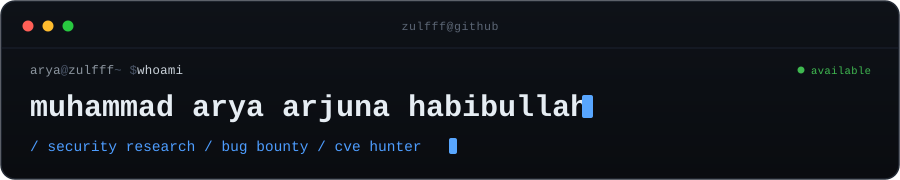

  

  
  
  
  
  
  

  

 

<samp><u>./focus</u></samp>

  <code>memory safety</code>
  <code>tls / pqc</code>
  <code>waf &amp; ddos</code>
  <code>ebpf</code>
  <code>rust</code>
  <code>agent tooling</code>

 

<samp><u>./builds</u></samp>

| project | what it is |
| :------ | :--------- |
| [`argus`](https://github.com/zulfff/argus) | eBPF firewall and edge-router automation — XDP filtering, WireGuard ZTNA mesh, NetBox/VyOS reconcile |
| [`aegis-waf`](https://github.com/zulfff/aegis-waf) | WAF with behavioural threat detection and multi-layer DDoS mitigation, written in Rust |
| [`fortress-ws`](https://github.com/FortressCommunity/fortress-ws) | WebSocket gateway with threat detection, JWT auth, Redis rate limits and a gRPC Rust scanner |
| [`subhost`](https://github.com/zulfff/SubHost-demo) | DAG consensus, distributed storage and edge compute — quantum-resistant crypto, native IBC |
| [`lelouch`](https://github.com/zulfff/lelouch) | local-first compression of noisy tool output before it ever reaches the model |
| [`envforge`](https://github.com/zulfff/envforge) | zero-dependency config manager with validation, hot reload and secret masking |

 

<samp><u>./cves</u></samp>

3 verified · 1 pending attribution · 1 advisory-only · listed newest first

  <samp><b>CVE-2026-104255</b> · liboqs · medium · advisory</samp> 
  <b>LM-OTS key reuse and signature forgery in LMS stateful signing</b> 
  Fail-open lock handling in LMS stateful signing allows LM-OTS key reuse. Tracked as advisory <code>GHSA-xv6c-h66p-6mfq</code>; no NVD record yet, so it is not counted in the verified set. 
  <code>cwe-787</code> <code>published 6 oct 2026</code> <code>patched 0.17.0</code> · <a href="https://github.com/open-quantum-safe/liboqs/security/advisories/GHSA-xv6c-h66p-6mfq">advisory ↗</a>

  <samp><b>CVE-2026-6325</b> · wolfssl · 7.5 high · attribution pending</samp> 
  <b>Out-of-bounds write in SetSuitesHashSigAlgo</b> 
  An oversized signature algorithms list writes past the destination buffer. NVD records 7.5 high while the CNA records 2.0 low, and attribution to this profile is still unconfirmed — so it stays out of the verified count. 
  <code>cwe-787</code> <code>published 25 jun 2026</code> · <a href="https://github.com/wolfSSL/wolfssl/pull/10204">patch ↗</a>

  <samp><b>CVE-2026-44518</b> · liboqs · 5.3 medium · fixed 0.16.0</samp> 
  <b>XMSS buffer overread</b> 
  XMSS and XMSS^MT verification fail to validate the caller-supplied signature length. A short buffer causes an out-of-bounds read whose bytes are consumed internally as hash input, with denial of service if the read crosses an unmapped page. 
  <code>cwe-125</code> <code>cwe-20</code> <code>published 29 may 2026</code> · <a href="https://nvd.nist.gov/vuln/detail/CVE-2026-44518">record ↗</a> <a href="https://github.com/open-quantum-safe/liboqs/security/advisories/GHSA-wf7v-fhxj-73m2">advisory ↗</a>

  <samp><b>CVE-2026-5188</b> · wolfssl · 8.1 high · patched</samp> 
  <b>Integer underflow in X.509 Subject Alternative Name parsing</b> 
  A malformed Subject Alternative Name entry can declare a length larger than its enclosing sequence, wrapping the internal counter. Limited to configurations using the original ASN.1 parser, which is disabled by default. 
  <code>cwe-191</code> <code>cvss 3.1 8.1 high (nvd)</code> <code>cvss 4.0 2.3 low (cna)</code> <code>published 10 apr 2026</code> · <a href="https://github.com/wolfSSL/wolfssl/pull/10024">patch ↗</a>

  <samp><b>CVE-2026-3229</b> · wolfssl · 5.5 medium · patched</samp> 
  <b>Integer overflow in certificate chain allocation</b> 
  An integer overflow in <code>wolfssl_add_to_chain</code> writes certificate data past an undersized buffer and corrupts the heap. Not directly remote — exploitation needs the certificate-loading context to be compromised first. 
  <code>cwe-122</code> <code>cvss 3.1 5.5 medium (nvd)</code> <code>cvss 4.0 1.2 low (cna)</code> <code>published 19 mar 2026</code> · <a href="https://github.com/wolfSSL/wolfssl/pull/9827">patch ↗</a>

 

<samp><u>./stack</u></samp>

  

  <code>ffuf</code>
  <code>nuclei</code>
  <code>amass</code>
  <code>ghidra</code>
  <code>radare2</code>
  <code>impacket</code>
  <code>bloodhound</code>

 

<samp><u>./activity</u></samp>

  <samp>$ 3 verified cves · 2 libraries patched</samp> 
  <samp>$ <a href="https://github.com/zulfff?tab=repositories">67 public repositories</a></samp> 
  <samp>$ joined github in 2024</samp> 
  <samp>$ <a href="mailto:arjunaajalahla100@gmail.com">arjunaajalahla100@gmail.com</a></samp>

  

<samp>contribution snake</samp>

 

  

 

  <samp>report responsibly · patch quickly</samp>

